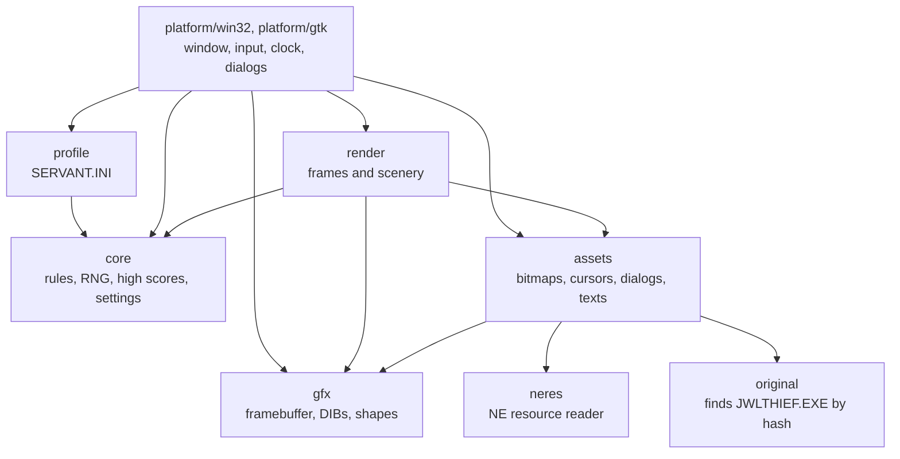

# Jewel Thief — a faithful native port

A native reimplementation of **Jewel Thief** (Paul Ligeski / ServantWare,
1991–1993), the 16-bit Windows 3.x game where the mouse cursor is a thief
stealing jewels from guards. Rebuilt in C99 from a reverse engineering of
the original, it plays like the original, down to its formulas, its pace and
its quirks, built for every Windows from XP to 11 and for Linux.

The repository holds **no original code or assets**. The game loads its
graphics, cursors, menu, dialogs and texts at runtime from your own copy of
the original `JWLTHIEF.EXE` v1.4.

## Highlights

- **Same rules, same numbers.** Guard counts and speeds, jewel placement,
  scoring, extra lives and the order of every `rand()` call are transcribed
  from the original code, including the Microsoft C random number generator.
- **Same pace.** The game ticks every 54.9 ms, the Windows 3.1 timer rate the
  original actually ran at, also while dialogs are open.
- **Same look.** The seven scenes are redrawn from the original's shapes and
  coordinates, and sprites get the colors they had in 256 colors on any
  display, without the original's high-color glitch.
- **Same dialogs and menu on Windows.** They are built from the original's
  own Windows 3.x templates, converted to Win32 on the fly. The Linux build
  uses native GTK 4 menus and dialogs instead, still with the original's
  texts; only its gameplay is kept faithful.
- **Compatible settings.** Options and high scores live in the original's
  `SERVANT.INI`, in its own format, next to `JWLTHIEF.EXE`.

How the original works and what the port does about it is documented in
[`docs/research.md`](docs/research.md).

## Playing

1. Get the original **Jewel Thief v1.4**; it ships in `JWLTHF14.ZIP`. The
   executable is recognized by its SHA-256, whatever its name. See
   [`original/`](original/README.md).
2. Put `jthief_32.exe` or `jthief_64.exe` in the folder that holds
   `JWLTHIEF.EXE`, and run it.

The folder can also be given on the command line:

```sh
jthief_64.exe [--debug] [folder of JWLTHIEF.EXE]
```

| Executable      | Built for                     |
|-----------------|-------------------------------|
| `jthief_32.exe` | Windows XP to Windows 11      |
| `jthief_64.exe` | 64-bit Windows                |
| `jthief`        | Linux, with GTK 4             |

### Controls

| Input | Action |
|-------|--------|
| Mouse | Move the thief; touch a jewel to take it |
| F2    | New game |
| F3    | Pause |

### Debug mode

`--debug` turns on keys the original never had, and the title bar shows
`[DEBUG]` while it is on:

| Key                     | Action |
|-------------------------|--------|
| Home                    | Toggle god mode: guards and leaving the field cost no lives |
| Page Up / Page Down     | Next / previous level |

## Building

The Windows executables are cross-compiled with MinGW-w64, and the Linux
one needs GTK 4; all need CMake 3.21 or newer. On Fedora:

```sh
sudo dnf install cmake mingw32-gcc mingw64-gcc   # wine, to run the builds on Linux
sudo dnf install gcc gtk4-devel                  # the Linux build
```

Each preset builds in `build/<preset>/` and puts the game in
`bin/<config>/`:

| Preset          | Output                       |
|-----------------|------------------------------|
| `win32-release` | `bin/release/jthief_32.exe`  |
| `win64-release` | `bin/release/jthief_64.exe`  |
| `win32-debug`   | `bin/debug/jthief_32.exe`    |
| `win64-debug`   | `bin/debug/jthief_64.exe`    |
| `linux`         | `bin/debug/jthief` and tests |

```sh
cmake --preset win64-release
cmake --build --preset win64-release
wine bin/release/jthief_64.exe original/

cmake --preset linux
cmake --build --preset linux
bin/debug/jthief original/
```

The tests run on the `linux` preset; those needing the original look for it
in `original/` (override with `-DJT_ORIGINAL_DIR=<dir>`) and are skipped
without it:

```sh
cmake --preset linux && cmake --build --preset linux
ctest --test-dir build/linux --output-on-failure
```

## Architecture

Everything but `src/platform/` is portable C99 with no Windows or GTK
dependency.



| Path                     | Purpose |
|--------------------------|---------|
| `src/core/`              | Game rules and state, the Microsoft C `rand()`, high scores, settings |
| `src/render/`            | Draws frames and the seven scenes into a framebuffer |
| `src/gfx/`               | 32-bit framebuffer, DIB and cursor decoding, the original's sprite raster operation, GDI-like shapes |
| `src/assets/`            | Reads bitmaps, cursors, icons, resources and texts from the original executable |
| `src/neres/`             | Reader for 16-bit NE executables: resources and data segment |
| `src/original/`          | Finds the user's v1.4 executable by its SHA-256 |
| `src/profile/`           | Options and high scores in `SERVANT.INI` |
| `src/common/`            | SHA-256, file system and INI helpers |
| `src/platform/win32/`    | Window, menu, clock thread, dialogs, Windows 3.x template conversion |
| `src/platform/gtk/`      | Linux: GTK 4 window, menu, clock thread and dialogs |
| `tests/`                 | CTest suite |
| `tools/ne.py`            | Inspect an NE executable or extract its resources |
| `tools/ghidra/`          | Headless Ghidra pipeline used to reverse engineer the original |
| `cmake/`                 | MinGW-w64 toolchains for 32- and 64-bit Windows |
| `docs/research.md`       | The original, its internals, and the port's decisions |

## Reverse engineering

The port was written from a static analysis of the original in
[Ghidra](https://ghidra-sre.org/) 12, driven from the command line:

```sh
tools/ghidra/analyze.sh   # import, Win16 fixups, auto-analysis, recovered symbols
tools/ghidra/export.sh    # decompiled C and TSV indexes of functions, globals, strings
```

`analyze.sh` keeps its Ghidra project in `../<repo>.ghidra` and `export.sh`
writes to `../<repo>.re/export`, both outside the repository: they derive
from the copyrighted original and are never committed. The scripts fix what
Ghidra gets wrong in Microsoft C Win16 code (inline switch tables, FAR
PASCAL callbacks, Win16 API prototypes) and apply the names and types
recovered so far, kept in
[`tools/ghidra/symbols/jwlthief.symbols`](tools/ghidra/symbols/jwlthief.symbols).

## Credits

Jewel Thief was written by Paul Ligeski and published by ServantWare. This
project is an independent reimplementation for preservation and study; it
contains none of the original's code or assets, and needs a copy of the
original to run.
